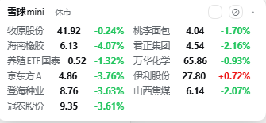
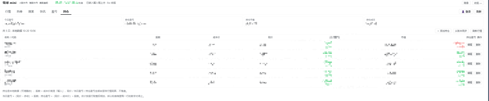

# dsh-market-dock · Market Panel for DeepSeek Harness

> A market panel docked above the composer in DeepSeek Harness: **no login required** — live A-share / HK / US quotes, candlestick & intraday charts, hot lists, search, 7×24 news. Plus a draggable mini quote badge, a one-line index strip above the input box, local holdings with live-computed P&L, price alerts, and a "hide the market" switch that makes every market surface and request disappear — and comes back in one click.

[](./LICENSE)
[](#installation)
[](#disclaimer)

[中文](./README.md) | English

> This repository is a derivative of [dsh-xueqiu](https://github.com/wanderer-yk/dsh-xueqiu) (MIT): the data endpoints, panel and charts come from upstream; local holdings, live P&L, host-side price alerts and the hide switch are added here. See [FORK-NOTES.md](./FORK-NOTES.md) for the full change log and design rationale.

---

## Features

| Module | Description |
|---|---|
| 📈 Market panel | A panel above the composer (`conversation.input.dock`), Esc to collapse. Six tabs: **Market** (four indices + watchlist), **Hot**, **Search**, **News**, **P&L**, **Positions**. |
| 🏷 Detail view | Click any symbol: large last price with change and percent, 16 stat cards, candlestick chart (candles + volume + MA) and intraday chart, 7 periods (5/15/30/60 min, daily/weekly/monthly). |
| 🔖 Mini badge | A draggable floating badge (`shell.overlay`) that can collapse to a single line; position and size are persisted. Rotates watchlist and index quotes. |
| 📊 Index strip | A permanent one-line row with the four major indices (SSE / SZSE / ChiNext / CSI 300) above the input box, on its own line. |
| 💼 Local holdings | Maintain positions (symbol / shares / cost) in the **Positions** tab. Day P&L, position P&L and market value are computed from live quotes — no ledger API involved. |
| 🧮 Day P&L | A chip in the panel header. Optionally import from the THS (同花顺) investment ledger once (paste a Cookie); the ledger is only queried when you click "sync from ledger", and a dead Cookie never breaks live P&L. |
| 🔔 Price alerts | Set an upper/lower bound per symbol; a system notification fires when hit. Detection runs **host-side**, independent of the page. |
| 🙈 Hide the market | One click unmounts panel, badge and index strip and **stops all market polling (zero requests)**; price alerts keep working. Three ways back, see below. |
| 🤖 Agent tools | Seven tools plus four tool cards, so the model can fetch quotes, K-lines, hot lists, news, resolve symbols, list KOLs, and toggle the hide switch. |

### Where the UI lives

```
┌──────────────────────────────────────────────┐
│ conversation                                 │
└──────────────────────────────────────────────┘
  ┌ Market panel (collapsible) ─────────────┐   ← conversation.input.dock
  │ Market Hot Search News P&L Positions[↻] │
  └─────────────────────────────────────────┘
  SSE 3960.19 +0.84%  SZSE 14534.46 +1.26% …    ← conversation.composer.dock
┌──────────────────────────────────────────────┐
│ composer                                     │
└──────────────────────────────────────────────┘
                          ┌ mini badge ┐          ← shell.overlay (draggable)
```

---

## Screenshots

**Mini quote badge** — draggable, collapsible to a single line; the `⊘` on the right is the "hide the market" switch, `−` collapses it, and both position and size are remembered.



**Holdings and P&L** — positions are the local source of truth (add/edit/delete freely); day P&L, position P&L and market value are computed from live quotes, never written to disk and never dependent on the ledger.



> Symbols and amounts in these screenshots have been pixelated.

---

## Installation

### Option 1: install as a bundle plugin (recommended)

```bash
# from GitHub
dsh plugin --profile web add github:xxxSnack/dsh-market-dock

# or from a local directory (easiest for development)
dsh plugin --profile web add /abs/path/to/dsh-market-dock
```

Then **restart `dsh web` once** (plugin rows are discovered at startup) and refresh the page.

Manually, this is equivalent to two entries in the profile's `package.json` (`~/.dsh/profiles/web/package.json`):

```jsonc
{
  "dependencies": { "dsh-market-dock": "link:/abs/path/to/dsh-market-dock" },
  "dsh": { "profile": { "bundles": ["…", "dsh-market-dock"] } }
}
```

and a `node_modules/dsh-market-dock` entry pointing at the plugin directory (either a `link:` dependency or a symlink).

### Option 2: load the dynamic plugin

`dynamic/host.js` and `dynamic/client.js` are built from the same sources for DSH's dynamic plugin runtime. Load them in any session with `cordis_define` (kind: new) + `cordis_run` — no profile changes needed. Both forms have the same capabilities; only installation differs.

> **Changing `lib/` requires a `dsh web` restart; changing `client/` or CSS only needs a page refresh** (client bundles are not hot-reloaded unless `pnpm run dev:web` is running).

---

## Usage

### Quotes and watchlist

The **Market** tab shows the four indices on top and your watchlist below; click a row for the detail view. "Refresh" triggers an update manually; otherwise polling adapts to the trading session (long back-off after close) with TTL caching and request throttling.

Search accepts Chinese names, pinyin, tickers and bare codes ("茅台" / "maotai" / "600519" / "00700").

### Holdings and P&L

Positions in the **Positions** tab are the source of truth, stored in a local file:

- Add a position by symbol + shares + cost; edit or delete at any time.
- "Sync from ledger" is an optional one-off import / reconciliation against the THS ledger. It only issues a request when clicked.
- Day P&L = local holdings × live Xueqiu quotes. An expired ledger Cookie or a broken ledger endpoint does not affect it.

### Price alerts

Set an upper or lower bound per symbol and get a system notification when it is crossed. Detection runs in a host-side watcher, so closing the panel, refreshing the page or collapsing the badge does not stop alerts. If notification permission is missing, you will be asked on the first trigger (the hide button and the restore pill also request it as a side effect of a user gesture).

### Hiding the market

Three entry points:

1. the **hide** button in the panel header;
2. the **⊘** button on the badge;
3. telling the agent "hide the market".

After that, panel, badge and index strip are **unmounted** (not CSS-hidden) and all market polling stops — genuinely zero quote requests. Price alerts keep working.

Three ways back, deliberately cheaper than hiding:

| Entry point | How |
|---|---|
| Restore pill | A small `● Market` pill in the bottom-left corner; **a single click restores** (Enter / Space also work) |
| Keyboard shortcut | `Ctrl + Alt + Shift + X` (`⌘ + Alt + Shift + X` on macOS), rebindable in **Settings → General → Shortcuts** |
| Agent tool | Ask the model to call `xueqiu_display` with `hidden: false`, or just say "bring the market back" |

The hidden flag is **host-level**, stored in `$DSH_HOME/dsh-xueqiu/.xueqiu-ui-state.json` — it survives refresh, restart, workspace switches and browser changes.

### Agent tools

| Tool | Purpose |
|---|---|
| `xueqiu_quote` | Real-time quote snapshot (A-share / HK / US / index / ETF) |
| `xueqiu_kline` | Historical K-lines (OHLCV + change), for trend analysis and indicators |
| `xueqiu_search` | Resolve a name / pinyin / code ("茅台" → `SH600519`) |
| `xueqiu_hot` | Hot list |
| `xueqiu_news` | 7×24 news feed |
| `xueqiu_kol` | Trending KOLs discussing a symbol |
| `xueqiu_display` | Read / write the hide switch (`{hidden: true｜false}`; no argument = read-only) |

Tool calls render as cards in the conversation (quote / K-line / hot / news).

---

## Data and privacy

- **No cloud account, no API key.** By default the plugin scrapes Xueqiu's public web endpoints without logging in.
- **Optional login**: paste a Cookie from your browser to pull your cloud watchlist and best-effort sync add/remove. The Cookie is stored only in a local host file; neither the client nor the agent tools ever see the raw value.
- All state lives in local files:

| File | Contents |
|---|---|
| `$DSH_HOME/dsh-xueqiu/.xueqiu-watchlist.json` | Watchlist + last cloud sync time |
| `$DSH_HOME/dsh-xueqiu/.xueqiu-ui-state.json` | UI state (panel open, badge position/collapse, **hide flag**) |
| `$DSH_HOME/dsh-xueqiu/.xueqiu-login.json` | Optional login Cookie |
| `$DSH_HOME/dsh-xueqiu/.xueqiu-alerts.json` | Alert rules and fired events |
| `$DSH_HOME/dsh-ths-pnl/config.json` | Optional ledger Cookie (shared with the retired `dsh-ths-pnl`) |
| `$DSH_HOME/dsh-ths-pnl/positions.json` | Local holdings (shares / cost) |

- Nothing is uploaded to third parties. Besides Xueqiu (quotes) and the optional THS ledger, no outbound requests are made.

---

## Relationship to upstream dsh-xueqiu

- This is a **replacement**, not a companion: agent tool names stay `xueqiu_*`, so running both registers duplicate tools. Uninstall `dsh-xueqiu` before installing this.
- The default state directory is still `$DSH_HOME/dsh-xueqiu/`, so watchlist, Cookie and UI position carry over when switching; set a different `stateDir` in the plugin config to isolate completely (existing data is not migrated automatically).
- Upstream improvements are welcome back at [wanderer-yk/dsh-xueqiu](https://github.com/wanderer-yk/dsh-xueqiu).

### Requirements

Targets DSH 0.2+ (after the host `shell` service rename) and is verified there; earlier versions are untested.

---

## FAQ

**The panel covers the composer?**
It sits above the composer inside the conversation area; press Esc or use "collapse". The badge can be dragged anywhere and remembers its position.

**Why did it stop refreshing?**
Polling backs off outside trading hours, and stops entirely while hidden. Click "Refresh", or check whether the `● Market` pill is in the bottom-left corner.

**Is the data accurate?**
Quotes come from Xueqiu's public endpoints, the same source as the Xueqiu website. P&L is computed as local holdings × quotes — shares and cost are whatever you entered. Trading sessions are inferred locally for Mon–Fri at fixed hours, **excluding public-holiday adjustments**; for reference only.

**Can the Cookie leak?**
No, it stays on your machine: it lives in a file under `$DSH_HOME` and is used by the host process. Neither the client bundle nor agent tools receive it.

**Does it patch DSH itself?**
No. All UI is mounted on official slots (`conversation.input.dock` / `shell.overlay` / `conversation.composer.dock`) and disappears completely when uninstalled.

---

## Credits

This project builds on the following open-source work:

| Project | License | Relation |
|---|---|---|
| [wanderer-yk/dsh-xueqiu](https://github.com/wanderer-yk/dsh-xueqiu) | MIT | **Upstream.** The 1.22.15 baseline for this fork: Xueqiu request layer, panel/badge UI, chart integration, tool definitions, build and test scaffolding |
| [PM25000/dsh-ths-holdings](https://github.com/PM25000/dsh-ths-holdings) | MIT | **Reference implementation.** The THS ledger data path (endpoints, field semantics, Cookie parsing) was rewritten after studying it; no verbatim code |
| [klinecharts/KLineChart](https://github.com/klinecharts/KLineChart) | Apache-2.0 | **Third-party component.** `assets/klinecharts.min.js` (v10.0.2, UMD) is vendored as-is and renders candlestick and intraday charts |
| [fanxinqi/xueqiu-cli](https://github.com/fanxinqi/xueqiu-cli) | MIT | **Inspiration.** The optional "paste a Cookie" login flow; no code copied |

Full copyright lines and license texts are in [THIRD-PARTY-NOTICES.md](./THIRD-PARTY-NOTICES.md).

## Third-party components and licensing

This repository is released under [MIT](./LICENSE). The vendored KLineChart is distributed under **Apache-2.0**, and its `NOTICE` additionally requires the attribution of **TradingView Lightweight Charts** (© 2019 TradingView, Inc.); both are preserved verbatim in [THIRD-PARTY-NOTICES.md](./THIRD-PARTY-NOTICES.md). Keep `LICENSE` and that file together with any redistributed build artifact.

---

## Disclaimer

- This project is **not affiliated with Xueqiu (Snowball)**. "雪球" is a trademark of Xueqiu Inc. and is used here only to describe the data source. Same for the THS investment ledger.
- Data comes from Xueqiu's public web endpoints, for **learning and research only**. It is **not investment advice**. Please do not poll aggressively and respect the source site's terms.
- Endpoints may change or break at any time. Issues and PRs are welcome; use at your own risk.

## Changelog

Changes relative to upstream 1.22.15:

- **1.0.0** — renamed to `dsh-market-dock` and published: local holdings with live-computed P&L (ledger downgraded to a one-off import), price alerts promoted to a host-level runtime, a hide switch with three restore paths (bottom-left pill, rebindable shortcut, agent tool), DSH 0.2 `shell` service compatibility, and input hardening for watchlist and ledger form values.
- Upstream 1.22.x release notes live in the upstream repo; implementation details and trade-offs are in [FORK-NOTES.md](./FORK-NOTES.md).

---

⭐ **If this plugin is useful to you, a Star would be appreciated** — it genuinely helps a lot; issues and feature requests are welcome too.
